# MegaGB

A cycle accurate emulator for the Gameboy and Gameboy Color consoles in C, with pixel FIFO emulation for high accuracy and emulation precision. This was done as a hobby project from scratch, using only hardware documentation. This was integrated with ImGUI in C++ to show internal information, disassembly support and allow configurations.

The process involved implementing every CPU, Memory and Graphics related component of the console in software, keeping in mind intricate functioning and interplay of the components. This had to be done to a level of precision where the games/software dedicated to the Gameboy ran identically on the emulator, as on the real hardware. 

## Key Design Highlights and Features

• The core emulator (without GUI), i.e CPU, Memory, PPU, Timers, Hardware Registers are a challenge to emulate as they run in parallel on the real hardware. All these components in the emulator run on a single thread. Syncing, scheduling and context switching is done, often times several times per CPU instruction, such that these parallel components running together are emulated at a very high accuracy. 

• Every CPU instruction was implemented manually in code, keeping in mind read/write timings and syncing with other hardware components like the Hardware Timers, Registers and Pixel Processing Unit, at CPU cycle granularity.  

• Additionally, for emulating the graphics, the entire Pixel First-In-First-Out (FIFO) hardware mechanism was emulated, to get maximum accuracy. This replicated changes to display accurately at dot and instructional level granularity (for example: Mid-scanline writes to video memory are replicated correctly at the CPU cycle level), matching very closely to how the actual hardware does it. Every pixel is processed and pushed individually as part of this FIFO and this is intertwined with the CPU Instructions running on the same thread.  

## Benchmarks of accuracy and completion

• Passes all of [Blargg's](https://github.com/retrio/gb-test-roms) CPU Instruction, Instruction timing, Interrupt and Memory timing test ROMs. 
• Passes [dmg_acid2](https://github.com/mattcurrie/dmg-acid2) and [cgb_acid2](https://github.com/mattcurrie/cgb-acid2) PPU tests. 
• Passes halt, call, ret, ei, div, timer and many more quirk tests in the [Mooneye test suite](https://github.com/Gekkio/mooneye-test-suite). 

## Development Timeline
• <i>September 2021 - December 2021</i> : CPU instruction set implementation, cycle accuracy and timing, interrupt handling, hardware registers and timer. 
• <i>May 2022 - August 2022</i> : PPU Pixel FIFO design and implementation, completion of essential components, memory bank controllers. 
• <i>December 2024</i> : Debug menu addition using ImGUI. 

## ROM Showcase
### Gameboy

| | | |
:---:|:---:|:---:
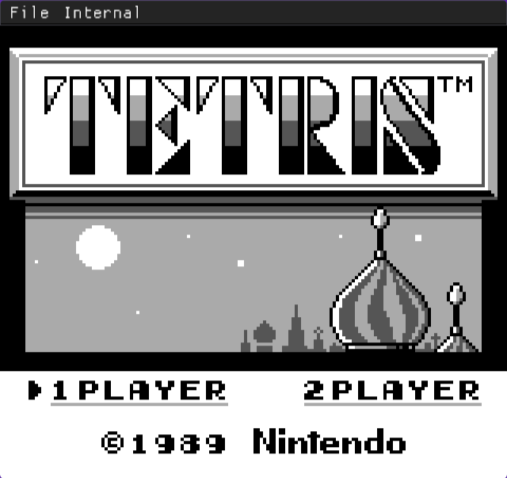  <b>Tetris</b> | 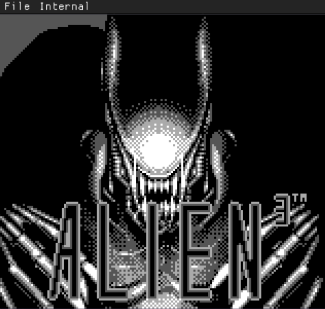  <b>Alien 3</b> | 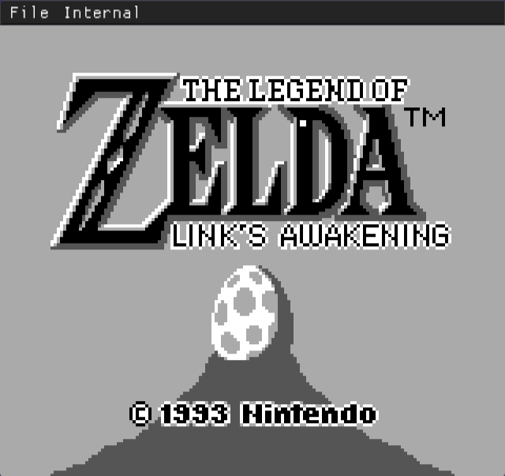  <b>Legend of Zelda - Link's Awakening</b>
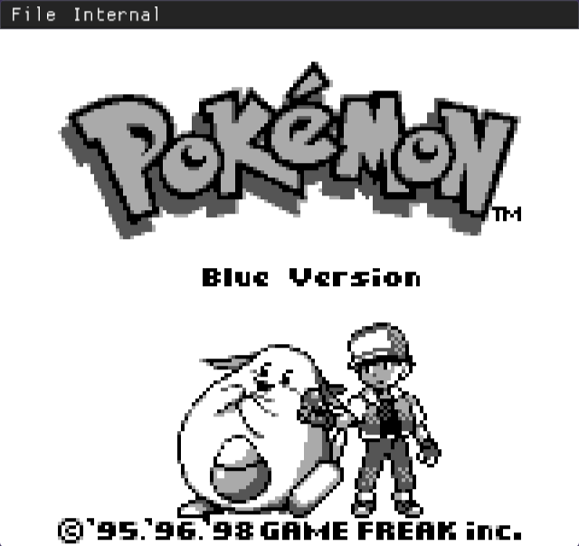  <b>Pokemon Blue</b> | 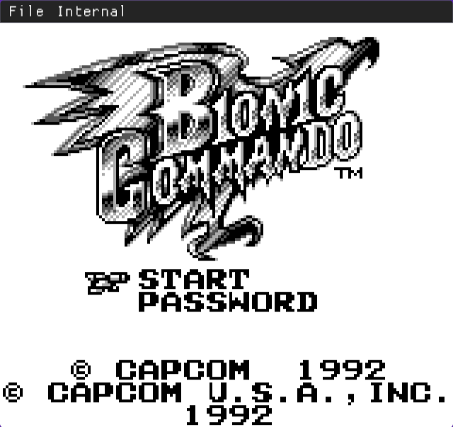  <b>Bionic Commando</b> | 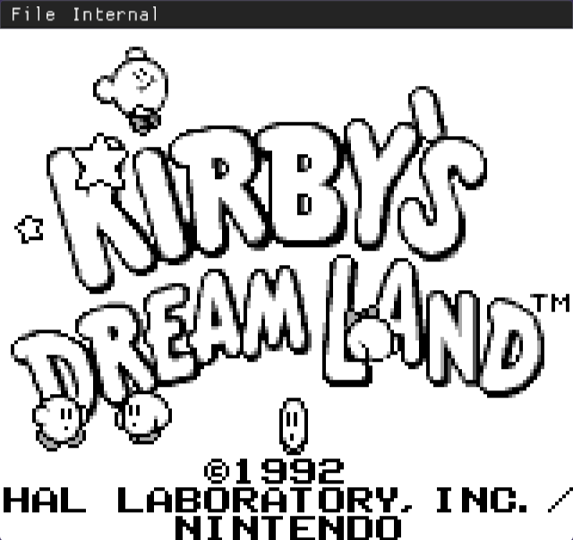  <b>Kirby's Dream Land</b>
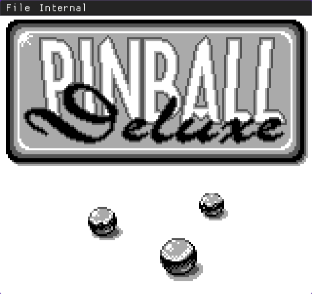  <b>Pinball Deluxe</b> | 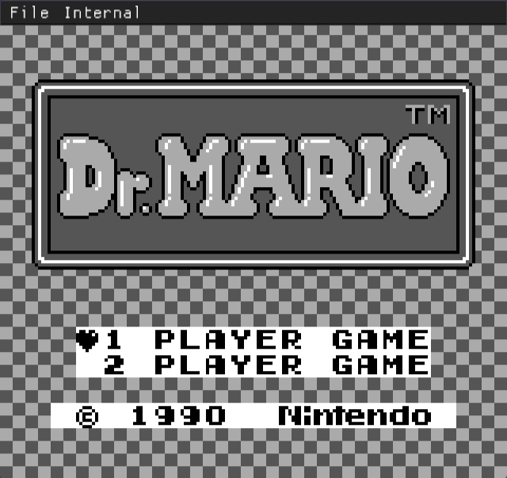  <b>Dr. Mario</b> | 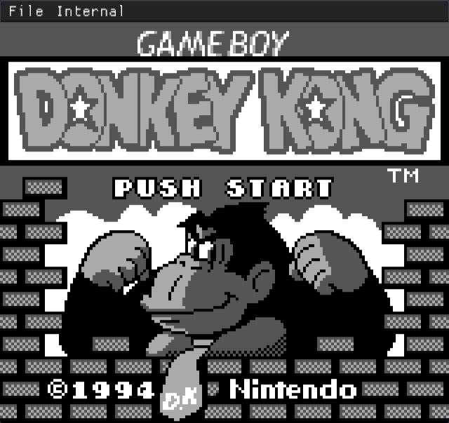  <b>Donkey Kong</b>

### Gameboy Color (Most features have been implemented)

| | | |
:---:|:---:|:---:
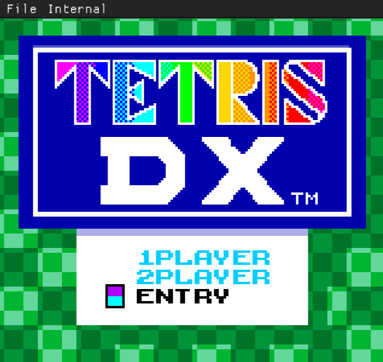  <b>Tetris DX</b> | 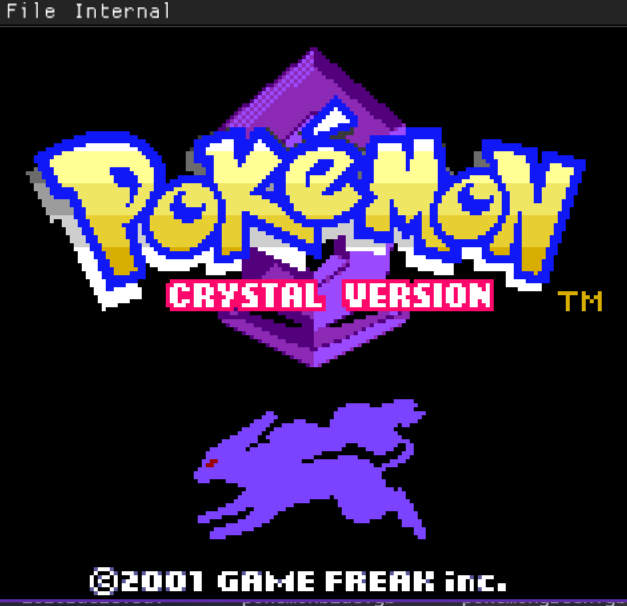  <b>Pokemon Crystal</b> | 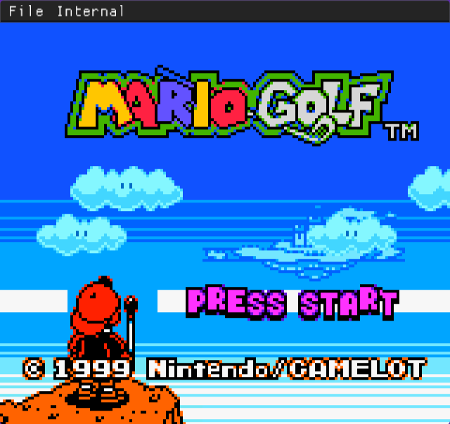  <b>Mario Golf</b>
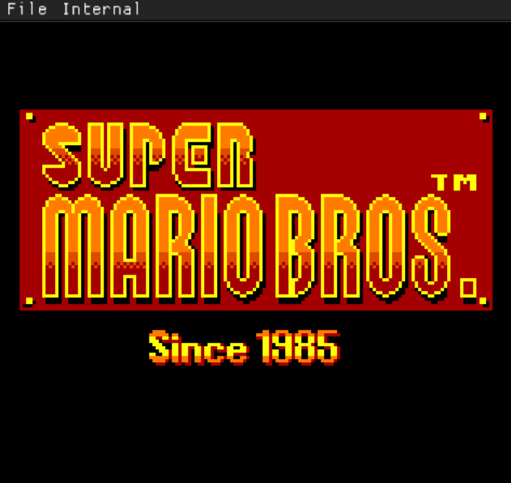  <b>Super Mario Bros</b> | 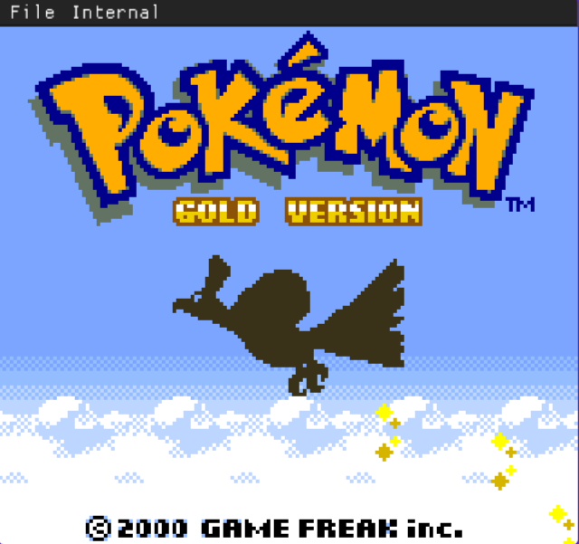  <b>Pokemon Gold</b> | 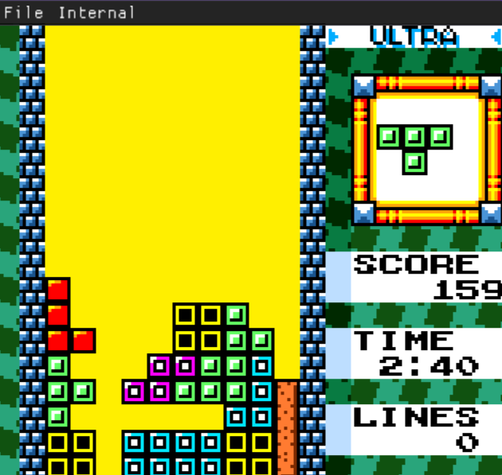  <b>Tetris DX Playthrough</b>

### Real time execution state viewer and color palette selector
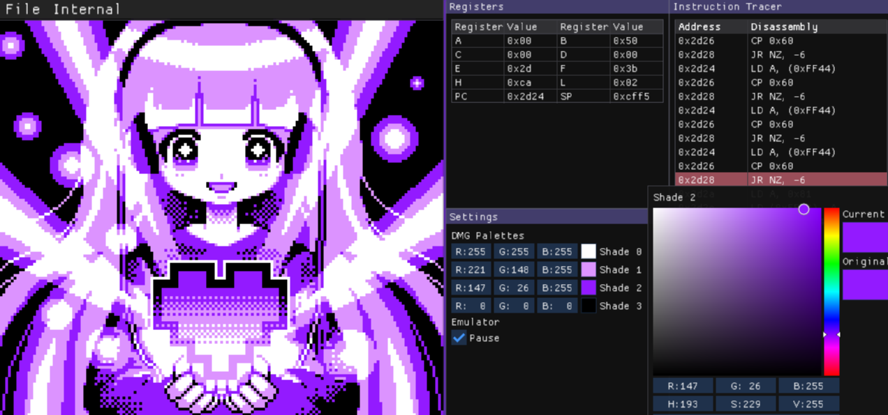

ROM: <i>Is that a demo in your pocket?</i>

## Current State
Currently the project is out of active development as it has reached a stable stage of functionality. However there are pending improvements that could be made
over the years as and when I feel like working on them:

• Adding more memory bank controller support to expand to more runnable games 
• Complete Gameboy color residual support 
• Add audio emulation 
• Better debugging UI and infrastructure 

## AI Usage Disclosure
The core emulator was developed before the public availability of modern generative AI tools and LLM-based coding assistants. 
No generative AI was used in the design, implementation, debugging, testing, or documentation of this project.

## References
• [Gameboy Pandocs](https://gbdev.io/pandocs/) - For hardware documentation and quirks  
• [izik1's Gameboy CPU opcode table](https://izik1.github.io/gbops/) - CPU Instruction encoding

